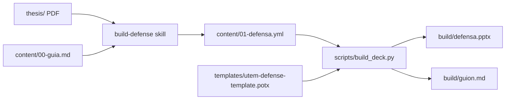

# How it works

<!-- An AI tool may draft this file from the real code, never from a guess. It stays a draft until the owner confirms it. Update it in the same change that alters the main flow. Paths in backticks must exist: the check reads them. -->

Status: draft.

## From start to finish

1. A student creates a copy of this repository with "Use this template" and puts the PDF of the thesis in a folder named thesis, which git ignores.
2. In Claude Code, the student runs the `build-defense` skill (`.claude/skills/build-defense/SKILL.md`). It reads the thesis and the rules in `content/00-guia.md`, and writes `content/01-defensa.yml`: one entry per slide with its pattern, text, seconds and speaker script.
3. `scripts/build_deck.py` opens the catalog `templates/utem-defense-template.potx`. For each entry it copies the pattern slide, fills the `{{markers}}`, removes list items the entry does not use, highlights the tab of the section, numbers the visible slides and hides the backup slides.
4. It writes the speaker script into the notes and saves `build/defensa.pptx` and `build/guion.md`, then warns about missing fields, missing images and a total time over the limit.
5. The student fixes the brackets, adds images in `figures/`, builds again and rehearses with `content/02-ensayos.md`.



## Parts

- `templates/utem-defense-template.potx`: the catalog, 17 pattern slides. The pattern name is the slide name. Shape names tell the build what to do: `tab:N` and `tabbar:N` are the section tabs, `footer:section` and `footer:page` the footer, `item:KEY` a shape removed when the entry lacks `KEY`, `img:KEY:keep|remove` a picture placeholder, `chart:KEY` a chart and `table:KEY` a table.
- `scripts/build_deck.py`: builds the presentation. `--models` lists each pattern and its fields. `--strict` fails on missing fields.
- `scripts/pptx_tools.py`: opening and saving .potx files, copying slides with their pictures and charts, deleting slides and unused relationships, replacing paragraph text while keeping its format, writing notes.
- `scripts/make_catalog.py`: maintainers only. Rebuilds the catalog from the source defense deck, which is not in this repository.
- `content/01-defensa.yml`: the example content, all placeholders between brackets. CI builds it.
- `tests/test_build_deck.py`: builds the example against the real catalog and checks markers, hidden slides, page numbers, notes and removed items.

## Where to start reading

`content/01-defensa.yml`, then `scripts/build_deck.py` from `build()`. The YAML shows what a student writes and `build()` shows what happens to each entry.

## Run it and check it

```bash
pip install -r requirements.txt
python scripts/build_deck.py
python -m unittest discover -s tests
```

The build prints the number of slides, the seconds of the visible slides and one warning per missing field or image.

## Not covered

- The build does not move text when an item is removed. Removed items leave space where they were.
- Long text is not resized. The student shortens it or adjusts it in PowerPoint.
- The chart pattern takes bar charts with categories and values. Other charts go in as images.
- `make_catalog.py` needs the source deck, so only the owner can rebuild the catalog.
